<!-- Animated profile cards are rendered by scripts/render_readme_cards.py and refreshed daily. -->

 
 
 
 

<a href="https://zjn281r.tech">zjn281r.tech</a> &nbsp;/&nbsp; <a href="https://github.com/zjn281r">github</a> &nbsp;/&nbsp; <a href="https://linkedin.com/in/zjn281">linkedin</a> &nbsp;/&nbsp; <a href="https://instagram.com/zjn281r">instagram</a> &nbsp;/&nbsp; <a href="https://behance.net/zjn281r">behance</a>

